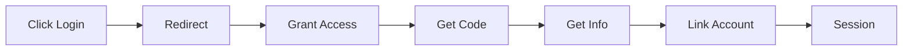
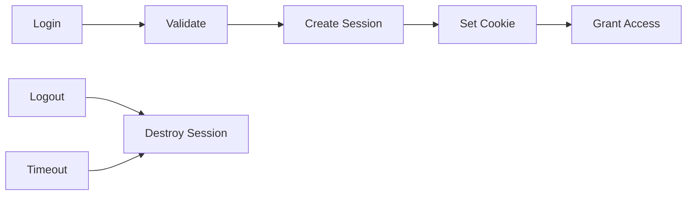
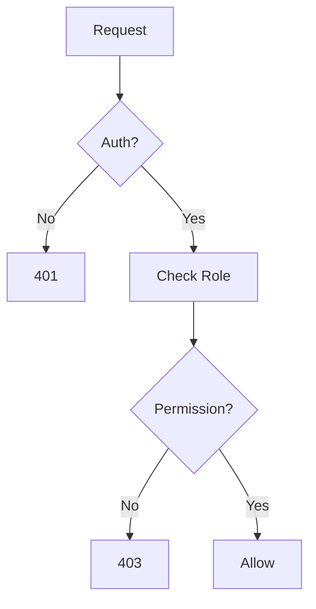

# Authentication & Authorization

Conducky implements a robust authentication system with multiple login methods and secure session management to protect user accounts and maintain system security.

## 🔐 Authentication Methods

### 1. Email/Password Authentication

**Standard login flow:**
- User provides email address and password
- Server validates credentials against hashed passwords
- Secure session is established upon successful authentication

**Security features:**
- **Password hashing**: Using bcrypt with salt for secure storage
- **Rate limiting**: Protection against brute force attacks
- **Account lockout**: Temporary lockout after failed attempts
- **Email verification**: New accounts must prove they own their email address (when email is configured; see [Email verification](#4-email-verification))

{/* Screenshot Placeholder */}
> **Screenshot needed**: Standard login form with security features highlighted

### 2. Social Authentication

Conducky supports OAuth integration with major providers:

#### Google OAuth 2.0
- **Scopes requested**: Email and basic profile information
- **Data collected**: Email address, name, profile picture
- **Account linking**: Can link multiple Google accounts to one Conducky account

#### GitHub OAuth
- **Scopes requested**: User email and public profile
- **Data collected**: Email address, username, avatar
- **Organization integration**: Respects GitHub organization membership when configured



### 3. Invite-Based Registration

**For new users joining through invitations:**
- Event administrators generate secure invite links
- Users click link and are prompted to create account
- Account is automatically associated with the invited event and role
- Immediate access to event functionality upon completion (after verifying their email address, when email is configured)

### 4. Email Verification

When email is configured, Conducky verifies that people own the address they sign up with.

**Who must verify:**
- New email/password signups, including signups through an invite link, must click an emailed link before they can sign in
- The first account on an instance (who becomes the System Admin) is verified automatically
- Accounts created before verification existed, or while email was not configured, are never locked out. They can verify at any time from a banner in the app

**Verification links:**
- **Hashed**: Only a hash of each token is stored; the raw token exists only in the email
- **Single-use**: A link cannot be reused
- **Address-bound**: A link only works for the address it was mailed to, so a link cannot be replayed after the address changes
- **Expiring**: Links expire after 24 hours and can be re-sent

**Protecting pending signups:**
- An unverified new account that tries to sign in with the right password sees "check your email" (with Resend and a way to fix a mistyped address). Requests to resend are always answered the same way, so they do not reveal whether an account exists
- A new account that never verifies is deleted after 7 days. This runs daily and at startup, counts from the last verification email that was sent successfully (accounts whose verification email never sent are not purged), and never runs while email is not configured
- Registering an address held by a still-pending unverified signup replaces that signup only if its last verification email (or, if none was ever sent, its creation) is more than 1 hour old. Otherwise the registrant gets "Email already registered."
- Login, registration, registration with an invite, verification, resend and correct-email requests share one rate limit of 5 requests per 15 minutes per IP. The "send me a verification email" button for existing accounts has its own limit (5 per 15 minutes per IP) and a 60 second cooldown per account

**Google and GitHub:**
- A provider sign-in is accepted only when the provider reports the email address as verified. Otherwise it is rejected
- When the provider email matches an existing account that is not verified, the sign-in links to that account and marks it verified
- If that account was a new signup still waiting for verification, its password is cleared (the person can set one with Forgot Password). This stops someone who pre-registered another person's address from keeping a password for the account
- If it was an older account (created before verification existed, or while email was not configured), the password is kept. This is a documented, accepted residual risk: for those accounts there is no proof the password holder owns the address

**Changing your email address:**
- When email is configured, a change is not applied until the new address is verified; the current address stays in use
- The old address receives a notice when the change is requested (with a partly masked new address, and advice to change the password if it was not the account owner) and a confirmation when it takes effect. There is no cancel link
- Only the newest change link works, a new request is refused for 60 seconds after the last one, and changing or resetting the password cancels any pending change link (and a not-yet-verified signup's current verification link, so the person requests a new one)
- The change link opens a page that asks the person to confirm with a button; nothing is applied just by opening the link. This stops email security scanners that open links from confirming a change on their own. Signup verification links still verify automatically when opened
- If email is not configured, the change is applied immediately and the new address is treated as unverified

**When email is not configured:** verification is skipped entirely. Nobody is blocked, nothing is purged, and anyone can sign up with any address. An unverified account that signs in while email is not configured is exempted from verification for good, so it is never purged if email is set up later. The backend logs a warning at startup and System Admins see a warning banner on every `/admin` page. Setting up email is strongly recommended; see [Email configuration](../admin-guide/system-configuration.md#email-configuration).

All verification actions are written to the [audit log](./audit-logging.md#email-verification-events).

## 🔑 Session Management

### Session Security

**Session Configuration:**
- **Secure cookies**: HTTPS-only in production
- **HttpOnly flags**: Prevents client-side script access
- **SameSite protection**: CSRF attack prevention
- **Session expiration**: Configurable timeout periods

**Session Storage:**
- **Server-side sessions**: Session data stored on server, not in cookies
- **Session rotation**: New session ID generated on login
- **Secure logout**: Complete session destruction on logout

### Session Lifecycle



## 🛡️ Security Features

### Password Security

**Requirements:**
- Minimum 8 characters
- Must include letters, numbers, and symbols
- Cannot be common passwords (dictionary check)
- Cannot reuse last 3 passwords

**Protection Measures:**
- **Bcrypt hashing**: Industry-standard password hashing
- **Salt generation**: Unique salt per password
- **Hash verification**: Secure password comparison
- **Password reset**: Secure token-based reset process

### Multi-Factor Authentication (MFA)

**Status**: Coming soon

Multi-factor authentication support is planned for a future release. Currently, account security relies on:
- Strong password requirements
- Session management with secure cookies
- Account lockout protection
- Login attempt monitoring

{/* Screenshot Placeholder */}
> **Screenshot needed**: MFA setup interface with QR code and backup codes (future feature)

### Account Security Monitoring

**Automated Monitoring:**
- **Login anomaly detection**: Unusual login patterns
- **Geographic anomalies**: Logins from new locations
- **Device fingerprinting**: Track login devices
- **Session monitoring**: Multiple concurrent sessions

**Security Alerts:**
- **Email notifications**: For suspicious login attempts
- **Admin alerts**: For repeated failed attempts
- **Account lockout**: Automatic protection mechanisms
- **Audit logging**: All authentication events logged

## 🔒 Authorization Flow

### Request Authorization Process



### Permission Checking

**API Level:**
```typescript
// Example: Checking event access
const hasEventAccess = await checkEventPermission(
  userId, 
  eventId, 
  ['responder', 'event_admin']
);
```

**UI Level:**
```typescript
// Example: Conditional rendering
{hasRole('event_admin') && (
  <AdminPanel />
)}
```

## 🚨 Security Incidents & Response

### Failed Authentication Handling

**Rate Limiting:**
- **Progressive delays**: Increasing delays after failed attempts
- **IP-based limiting**: Temporary blocks for suspicious IPs
- **Account protection**: Lock accounts after repeated failures

**Incident Response:**
- **Automatic logging**: All failed attempts logged with details
- **Admin notifications**: Alerts for unusual patterns
- **Forensic data**: IP addresses, user agents, timestamps
- **Account recovery**: Secure process for locked accounts

### Suspicious Activity Detection

**Monitored Patterns:**
- **Brute force attempts**: Rapid password guessing
- **Credential stuffing**: Use of breached password lists
- **Session hijacking**: Unusual session characteristics
- **Privilege escalation**: Attempts to gain unauthorized access

**Response Actions:**
- **Immediate blocking**: Real-time threat prevention
- **Account notification**: Email alerts to account owners
- **Enhanced logging**: Detailed forensic information
- **Manual review**: Security team investigation for serious threats

## 🔧 Authentication Configuration

### For System Administrators

**OAuth Setup:**
1. **Configure providers** in System Settings
2. **Set callback URLs** for your domain
3. **Test integration** with development accounts
4. **Monitor usage** through admin dashboards

**Security Settings:**
- **Session timeout**: Configure expiration periods
- **Password policies**: Set complexity requirements
- **MFA enforcement**: Require for admin accounts
- **Rate limiting**: Adjust thresholds for your environment

{/* Screenshot Placeholder */}
> **Screenshot needed**: System admin OAuth configuration interface

### For Users

**Account Security:**
1. **Use strong passwords**: Follow security guidelines
2. **Enable MFA**: Add extra protection to your account
3. **Monitor sessions**: Review active sessions regularly
4. **Secure logout**: Always log out on shared devices

**Best Practices:**
- **Unique passwords**: Don't reuse passwords from other sites
- **Regular updates**: Change passwords periodically
- **Secure devices**: Keep devices updated and secure
- **Report issues**: Contact administrators about suspicious activity

## 📊 Authentication Metrics

### Security Monitoring Dashboard

**Key Metrics:**
- **Login success/failure rates**
- **Geographic distribution of logins**
- **Authentication method usage**
- **Session duration statistics**
- **Failed attempt patterns**

**Audit Reports:**
- **Daily authentication summary**
- **Weekly security incidents**
- **Monthly access pattern analysis**
- **Quarterly security review**

{/* Screenshot Placeholder */}
> **Screenshot needed**: Authentication metrics dashboard

## 🛠️ Troubleshooting Authentication

### Common Issues

**Cannot Login:**
1. **Check credentials**: Verify email/password accuracy
2. **Account status**: Confirm account is active
3. **Browser issues**: Clear cookies and cache
4. **Network problems**: Check firewall and connectivity

**Social Login Problems:**
1. **OAuth configuration**: Verify provider settings
2. **Email conflicts**: Check for account linking issues
3. **Permission errors**: Confirm OAuth scopes
4. **Browser blocking**: Disable popup blockers

**Session Problems:**
1. **Cookie settings**: Enable cookies for the site
2. **HTTPS issues**: Ensure secure connection
3. **Clock synchronization**: Check system time accuracy
4. **Multiple tabs**: Close other sessions

### Getting Help

**User Support:**
- **Password reset**: Use "Forgot Password" feature
- **Account recovery**: Contact event administrators
- **Technical issues**: Report to system administrators

**Administrative Support:**
- **User account issues**: Use admin user management
- **System problems**: Check authentication logs
- **Security incidents**: Follow incident response procedures

---

## Related Documentation

- **[Security Overview](./overview.md)** - General security principles
- **[Access Control](./access-control/overview)** - Role-based permissions
- **Data Protection** - Data security measures (coming soon)
- **[Admin Guide: System Configuration](../admin-guide/system-configuration.md)** - Authentication setup 